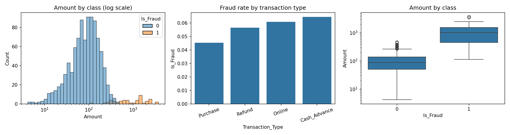
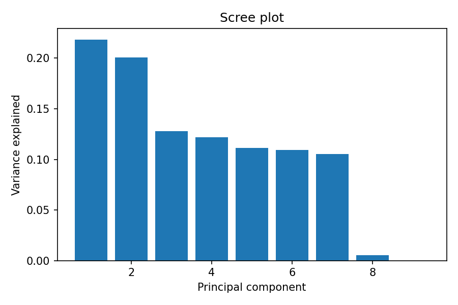
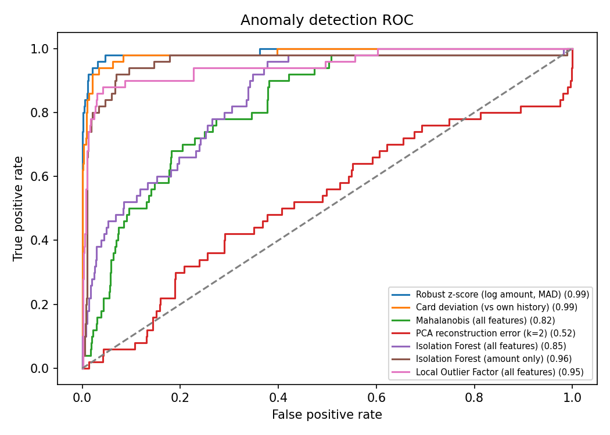
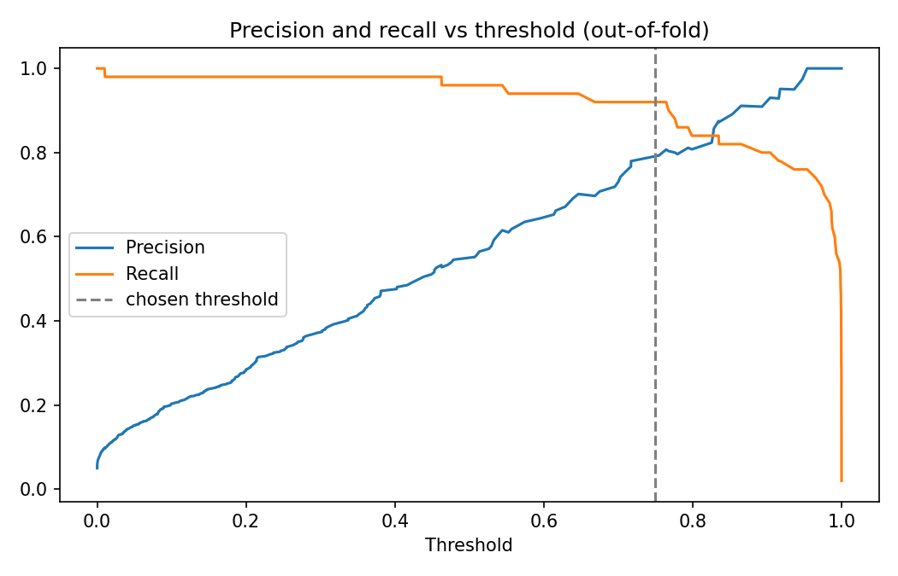

# Credit Card Fraud Detection: Linear Algebra, Statistics and Anomaly Detection

Detection of potentially fraudulent credit card transactions using matrix methods, statistical tests, anomaly detection and supervised models, with a cost-based flagging rule.

## Objectives
1. Represent transactions as vectors and matrices and apply linear algebra (covariance, eigendecomposition, SVD, Mahalanobis distance).
2. Use statistical tests and anomaly detection algorithms to identify irregular transactions.
3. Build and evaluate models that flag suspicious transactions for investigation, with honest validation.
4. Recommend an investigation workflow.

## Dataset
- 1,000 transactions on 100 cards and 20 merchants, 1 Jan to 30 Mar 2025. No missing values or duplicates. The data is synthetic.
- Fields: Transaction_ID, Date, Time, Amount, Merchant, Card_Number, Transaction_Type, Is_Fraud.
- Fraud is rare: **50 of 1,000 (5%)**. A model that always predicts "not fraud" would be 95% accurate, so accuracy is not used to judge models.

## How to run
```bash
pip install -r requirements.txt
python fraud_detection.py > results.txt
```
Output: [`results.txt`](results.txt), `flagged_transactions.csv` and `figures/`. The `Is_Fraud` column in the flagged file is included only to evaluate the flags.

## 1. What distinguishes fraud?
| | Legitimate | Fraud |
|---|---|---|
| Mean amount | 101.6 | 1,172.4 |
| Median amount | 87.9 | 1,014.7 |
| Maximum | 471.6 | 3,740.8 |
| Minimum | 4.2 | 112.4 |

- Amounts differ sharply (Mann-Whitney p = 1.6e-31). 37 of the 50 fraud cases exceed the largest legitimate amount, and all 25 transactions over 1,000 are fraud.
- **No other factor is related to fraud:** transaction type (chi-square p = 0.77), merchant (p = 0.65), day of week (p = 0.59) and hour of day (Mann-Whitney p = 0.23).



## 2. Linear algebra
Each transaction is a row vector, and the dataset is a 1000 × 9 matrix **X** with columns: log amount, hour (sine and cosine), weekend flag, deviation from the card's usual spend, and four transaction-type indicators. After standardising to **Z**, the covariance matrix is **C = ZᵀZ / (n-1)**.

**Eigenvalues of C:** 1.97, 1.81, 1.15, 1.10, 1.00, 0.98, 0.95, 0.05, 0.00.

- The spectrum is nearly flat: the first two components explain only 42% of the variance, and six are needed for 89%. The data has **no low-dimensional structure** for PCA to exploit.
- The last eigenvalue is 0 because the four transaction-type indicators sum to 1, so C is singular. The Moore-Penrose pseudo-inverse is therefore used for the Mahalanobis distance **d = √((x-μ)ᵀ C⁺ (x-μ))**.
- Mahalanobis distance measures how far a transaction lies from the centre in units that account for correlation between features.



## 3. Anomaly detection
Unsupervised: labels were never used for fitting, only to evaluate.

| Method | ROC AUC | Avg precision | Precision@50 |
|---|---|---|---|
| Robust z-score (log amount, MAD) | 0.990 | 0.937 | 0.84 |
| Card deviation (vs own history) | 0.985 | 0.897 | 0.80 |
| Isolation Forest (amount only) | 0.957 | 0.581 | 0.74 |
| Local Outlier Factor (all features) | 0.948 | 0.674 | 0.74 |
| Isolation Forest (all features) | 0.846 | 0.300 | 0.38 |
| Mahalanobis (all features) | 0.818 | 0.203 | 0.20 |
| PCA reconstruction error (k=2) | 0.522 | 0.057 | 0.06 |

**Interpretation.**
- Methods built on the amount alone score about 0.99. Methods that use all features perform much worse, because the extra dimensions (hour, weekday, type) are uninformative and dilute the distance calculations (the curse of dimensionality).
- PCA reconstruction error is near chance (0.52). That follows from the flat spectrum above: fraud here is not an unusual direction in feature space, only an unusually large value on one axis.
- Precision@50 means the 50 highest-scoring transactions contain 42 fraud cases (robust z-score).



## 4. Supervised models (5 × 5 repeated stratified cross-validation)
| Model | Features | ROC AUC | Avg precision |
|---|---|---|---|
| Logistic regression | Amount only | 0.989 ± 0.014 | 0.934 ± 0.061 |
| Random forest | Amount only | 0.969 ± 0.040 | 0.898 ± 0.087 |
| Logistic regression | + time + type | 0.981 ± 0.021 | 0.905 ± 0.090 |
| Random forest | + time + type | 0.982 ± 0.019 | 0.893 ± 0.090 |
| Logistic regression | + time + type + merchant | 0.965 ± 0.025 | 0.823 ± 0.109 |
| Random forest | + time + type + merchant | 0.970 ± 0.034 | 0.874 ± 0.097 |

With only 50 fraud cases, a single train/test split (as few as 15 fraud cases in the test set) is too noisy to rank models, hence the repeated cross-validation. Differences of 0.01 in AUC are within the spread. The clear pattern is that **adding features does not help**: the simplest model (logistic regression on log amount) is as good as or better than every richer model, and merchant indicators make it worse.

## 5. Final model and threshold
The final model is class-weighted logistic regression on log amount: each 1 sd increase in log amount multiplies the odds of fraud by about 78 (coefficient 4.36).

The threshold was chosen on **out-of-fold** probabilities, assuming a missed fraud costs 10 times an unnecessary review:

| Threshold | TP | FP | FN | Precision | Recall |
|---|---|---|---|---|---|
| 0.45 | 49 | 46 | 1 | 0.52 | 0.98 |
| 0.60 | 47 | 25 | 3 | 0.65 | 0.94 |
| **0.75** | **46** | **12** | **4** | **0.79** | **0.92** |
| 0.85 | 41 | 5 | 9 | 0.89 | 0.82 |
| 0.95 | 38 | 0 | 12 | 1.00 | 0.76 |

At 0.75, 58 transactions (5.8%) are flagged and 46 of them are fraud. The 4 missed cases have amounts of 112 to 280, which is below the 99th percentile of legitimate amounts (330), so they cannot be separated from normal spending using the available fields.

The cost is fairly flat between thresholds 0.45 and 0.75 (56 to 60, minimum 52 at 0.75), so the choice depends on the assumed cost ratio and should be revisited with real costs. Class weighting also inflates the predicted probabilities, so they are scores for ranking rather than calibrated probabilities.



## 6. Insights and recommendations
1. **Fraud is concentrated in high-value transactions.** Escalate every transaction above about 470 (the largest legitimate amount). In this data that catches 37 of 50 frauds with no false alarms.
2. **Add a manual review queue for mid-range amounts.** The 21 flagged transactions between 314 and 470 contain 9 fraud cases (43% precision). This is the price of raising recall from 74% to 92%.
3. **Do not build rules on merchant, time of day, weekday or transaction type.** None is related to fraud here, and including them lowers model performance.
4. **The remaining ~8% of fraud needs new data.** To catch low-value fraud, collect features such as location, device, merchant category, and the time and distance since the card's previous transaction.
5. **Review cards against their own history.** Card deviation performs nearly as well as the global amount rule (AUC 0.985). It matters more in real portfolios where customers' normal spending differs; here all cards spend similarly.
6. **Monitor and recalibrate.** Track precision and recall by month, and re-choose the threshold when fraud patterns or investigation costs change.

## Limitations
- Synthetic data in which fraud is defined mainly by amount. Real fraud is more varied, so these results will not transfer directly.
- Only 50 fraud cases, so all metrics have wide uncertainty (see the ± values).
- The rule "amount above the largest legitimate value" was derived from the same data it is evaluated on, so its zero false positives are optimistic.
- The threshold depends on the assumed 10:1 cost ratio, and probabilities are not calibrated.
- Transactions are treated as independent. No sequence, location or customer-history information is available.
